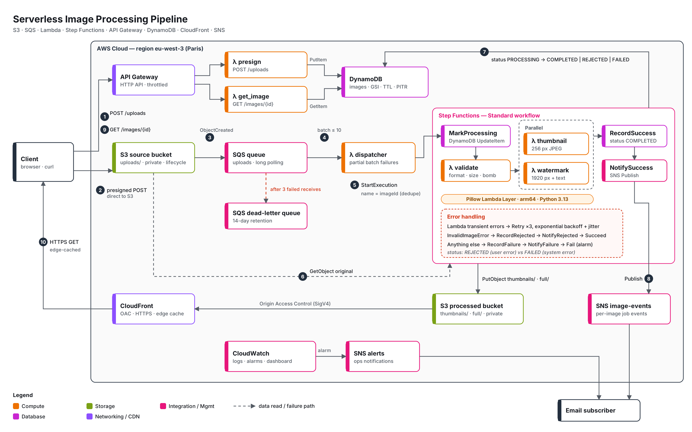
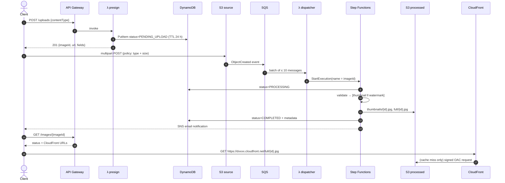
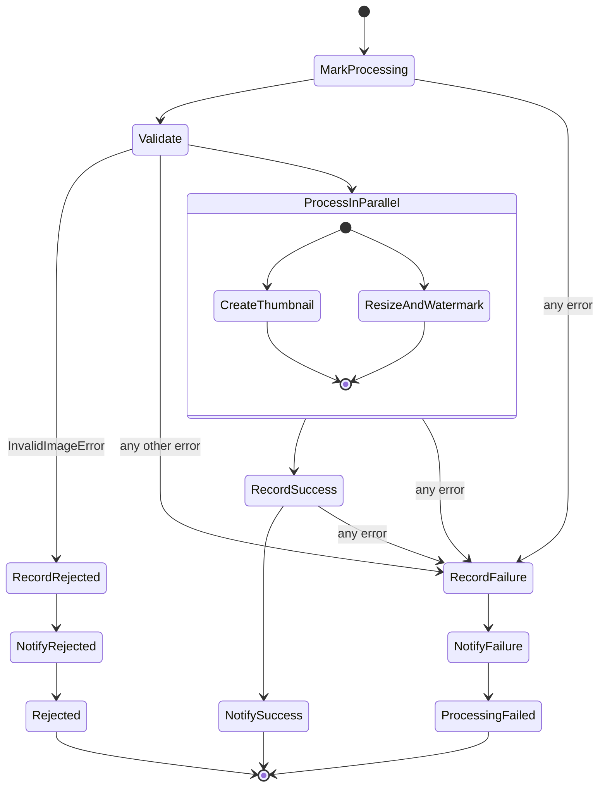

# Serverless Image Processing Pipeline on AWS

> AWS Solutions Architect – Associate · Graduation Project 2
> Event-driven image pipeline with **S3, SQS, Lambda, Step Functions, API Gateway, DynamoDB, CloudFront and SNS**, fully provisioned with **Terraform**.

**Author:** Mohamed El Abadi · [GitHub](https://github.com/Elabadi17) · [LinkedIn](https://www.linkedin.com/in/mohamed-e-b898a7255)

---

## Table of contents

1. [Overview](#1-overview)
2. [Solution architecture](#2-solution-architecture)
3. [How a request flows](#3-how-a-request-flows)
4. [The Step Functions workflow](#4-the-step-functions-workflow)
5. [AWS services and why each one is here](#5-aws-services-and-why-each-one-is-here)
6. [Data model](#6-data-model)
7. [API reference](#7-api-reference)
8. [Reliability and failure handling](#8-reliability-and-failure-handling)
9. [Security](#9-security)
10. [Cost optimisation](#10-cost-optimisation)
11. [Observability](#11-observability)
12. [Repository structure](#12-repository-structure)
13. [Deploy it yourself](#13-deploy-it-yourself)
14. [Testing](#14-testing)
15. [Well-Architected review](#15-well-architected-review)
16. [Limitations and next steps](#16-limitations-and-next-steps)

---

## 1. Overview

Users upload an image (JPEG, PNG or WebP, up to 20 MB). Without any server to manage, the platform:

1. **validates** the file is a real image (not just a file named `.jpg`) and extracts its metadata;
2. creates a **256 px thumbnail** and a **1920 px watermarked** web version **in parallel**;
3. stores the results in a private bucket served worldwide through **CloudFront**;
4. records every step in **DynamoDB** so clients can poll the status;
5. sends an **SNS** notification when the image is processed, rejected or has failed.

Key design properties:

| Property | How it is achieved |
|---|---|
| Image bytes never transit through Lambda or API Gateway on upload | Presigned **S3 POST** — the client uploads straight to S3 |
| Bursts of uploads don't overload the processors | **SQS** buffers events; dispatcher concurrency is capped |
| Each image is processed exactly once even if S3 sends the event twice | Step Functions **execution name = imageId** (unique for 90 days) |
| Failures are retried, then isolated | Step Functions **Retry** with backoff + jitter, SQS **DLQ** after 3 receives |
| Bad input ≠ system failure | `InvalidImageError` → status `REJECTED`, no alarm; anything else → `FAILED` + alarm |
| Nothing is publicly accessible except the API and CloudFront | Both buckets private, **Origin Access Control**, TLS-only bucket policies |
| Pay only for what runs | Lambda on **arm64**, DynamoDB on-demand, HTTP API, no NAT Gateway, no VPC |

## 2. Solution architecture



*The diagram is generated from code ([`docs/diagrams/generate_architecture.py`](docs/diagrams/generate_architecture.py)); an editable SVG is next to it.*

## 3. How a request flows



## 4. The Step Functions workflow

Definition: [`statemachine/image_pipeline.asl.json`](statemachine/image_pipeline.asl.json) (rendered by Terraform `templatefile()`).



Design choices worth noticing:

* **Direct service integrations** — `MarkProcessing`, `Record*` and `Notify*` call DynamoDB and SNS directly from Step Functions. No Lambda glue code, nothing to patch, no cold starts.
* **Standard (not Express) workflow** — exactly-once execution, execution-name idempotency and a visual history of every image, which matters more here than Express's lower cost at very high volume.
* **`Parallel` state** — the thumbnail and watermark tasks are independent, so total latency is `max(thumbnail, watermark)` instead of the sum.
* **Two failure paths** — a corrupt upload is the user's problem (`REJECTED`, execution *succeeds*, no alarm); a bug or an outage is ours (`FAILED`, execution *fails*, CloudWatch alarm).
* **`NotifySuccess` has no `Catch`** — if SNS is down, the image stays `COMPLETED` instead of being overwritten as `FAILED`.

## 5. AWS services and why each one is here

| Service | Role in the project | Configuration highlights |
|---|---|---|
| **Amazon S3 (source)** | Receives raw uploads under `uploads/` | Private, SSE-S3, TLS-only policy, CORS for browser POST, lifecycle: Standard-IA at 30 d → Glacier Instant Retrieval at 90 d → delete at 365 d, abort incomplete multipart after 1 d |
| **Amazon S3 (processed)** | Stores `thumbnails/` and `full/` | Private, readable only by CloudFront (OAC), Intelligent-Tiering after 30 d, `Cache-Control: immutable` on objects |
| **S3 Event Notifications** | `ObjectCreated:*` on `uploads/` → SQS | Queue policy restricted by `aws:SourceArn` + `aws:SourceAccount` |
| **Amazon SQS + DLQ** | Decouples upload from processing, absorbs bursts, enables retries | Long polling, visibility 180 s (6 × Lambda timeout), DLQ after 3 receives, 14-day DLQ retention, redrive-allow policy |
| **AWS Lambda** | 6 small single-purpose functions (Python 3.13, arm64) | One IAM role per function, own log group, partial-batch responses on the SQS consumer, max concurrency 5 on the event source mapping |
| **Lambda Layer** | Ships Pillow (≈ 24 MB) separately from the 50 KB function code | Built from manylinux wheels for the right CPU, no Docker needed |
| **AWS Step Functions** | Orchestrates validate → (thumbnail ‖ watermark) → record → notify | Standard type, Retry with exponential backoff + full jitter, Catch per error type, ERROR-level logging |
| **Amazon API Gateway (HTTP API)** | `POST /uploads`, `GET /images/{id}` | Throttling (10 rps / burst 20), CORS, JSON access logs |
| **Amazon DynamoDB** | Image metadata and status | On-demand, GSI `status-createdAt-index`, TTL on abandoned uploads, point-in-time recovery |
| **Amazon CloudFront** | Serves processed images from the edge | Origin Access Control (SigV4), HTTPS redirect, HTTP/2 + HTTP/3, managed caching + security-headers policies, PriceClass_100 |
| **Amazon SNS** | `image-events` (per-image result) and `alerts` (alarms) | Optional email subscription, `status` message attribute for subscription filtering |
| **Amazon CloudWatch** | Logs, alarms, dashboard | Alarms on DLQ depth, queue age, failed executions, Lambda errors |
| **AWS IAM** | Least-privilege roles | Each function can only touch its own prefixes (e.g. `thumbnail` can only write `thumbnails/*`) |

## 6. Data model

**Table `img-pipeline-<env>-images`** — partition key `imageId` (UUID v4), on-demand capacity.

| Attribute | Type | Set by | Description |
|---|---|---|---|
| `imageId` | S (PK) | presign | UUID, also the S3 object name and the Step Functions execution name |
| `status` | S | presign / workflow | `PENDING_UPLOAD` → `PROCESSING` → `COMPLETED` \| `REJECTED` \| `FAILED` |
| `contentType` | S | presign | Declared MIME type, enforced by the S3 POST policy |
| `originalFileName` | S | presign | Client file name (informational, max 255 chars) |
| `sourceKey` | S | presign | `uploads/{imageId}.{ext}` |
| `createdAt` | S | presign | ISO-8601 UTC, GSI sort key |
| `expiresAt` | N | presign | Epoch seconds, **TTL**: deletes records whose upload never arrives; removed when processing starts |
| `processingStartedAt`, `executionArn` | S | workflow | Link from the record to the execution for debugging |
| `width`, `height` | N | workflow | Original dimensions, EXIF orientation applied |
| `format` | S | workflow | Format detected by decoding (`JPEG`, `PNG`, `WEBP`) — not the declared type |
| `sizeBytes` | N | workflow | Size of the original |
| `thumbnailKey`, `fullKey` | S | workflow | Keys in the processed bucket |
| `completedAt` | S | workflow | Time the workflow reached a terminal state |
| `errorType`, `errorCause` | S | workflow | Only for `REJECTED` / `FAILED` (cause is never returned by the API) |

**GSI `status-createdAt-index`** — `status` (PK) + `createdAt` (SK), projecting `originalFileName`, `errorType`, `thumbnailKey`. Answers *"latest FAILED images"* with a `Query` instead of a `Scan`.

**S3 key layout**

```
source bucket                     processed bucket
└── uploads/{imageId}.{jpg|png|webp}   ├── thumbnails/{imageId}.jpg   (≤ 256 px)
                                       └── full/{imageId}.jpg         (≤ 1920 px, watermarked, EXIF stripped)
```

## 7. API reference

Base URL: `terraform output api_endpoint`

### `POST /uploads`

```http
POST /uploads
Content-Type: application/json

{ "contentType": "image/jpeg", "fileName": "holiday.jpg" }
```

`201 Created`

```json
{
  "imageId": "3f0c8f7e-5a8e-4d7e-9a8c-0f7e2b9c1d11",
  "upload": {
    "url": "https://img-pipeline-dev-source-a1b2c3.s3.amazonaws.com/",
    "fields": { "key": "uploads/3f0c8f7e-....jpg", "Content-Type": "image/jpeg", "policy": "...", "x-amz-signature": "..." }
  },
  "expiresInSeconds": 300,
  "maxBytes": 20971520,
  "statusUrl": "/images/3f0c8f7e-5a8e-4d7e-9a8c-0f7e2b9c1d11"
}
```

Then upload with a multipart form: every entry of `fields`, then the file **last**:

```bash
curl -F key=... -F Content-Type=image/jpeg -F policy=... ... -F file=@holiday.jpg "$URL"
```

`400` if `contentType` is not `image/jpeg`, `image/png` or `image/webp`.

### `GET /images/{imageId}`

`200 OK`

```json
{
  "imageId": "3f0c8f7e-5a8e-4d7e-9a8c-0f7e2b9c1d11",
  "status": "COMPLETED",
  "format": "JPEG",
  "width": 4032,
  "height": 3024,
  "sizeBytes": 3481220,
  "thumbnailUrl": "https://d1234abcd.cloudfront.net/thumbnails/3f0c8f7e-....jpg",
  "imageUrl": "https://d1234abcd.cloudfront.net/full/3f0c8f7e-....jpg"
}
```

`400` if the id is not a UUID, `404` if unknown.

## 8. Reliability and failure handling

| What can go wrong | What happens |
|---|---|
| Client uploads a 200 MB file or a `.exe` | S3 rejects it (`403`): the presigned POST policy pins `Content-Type` and `content-length-range` |
| File is named `.jpg` but isn't an image, is truncated, or is a decompression bomb | `validate` raises `InvalidImageError` → `REJECTED`, user notified, no retry, no alarm |
| S3 delivers the same event twice | Second `StartExecution` with the same name → `ExecutionAlreadyExists`, ignored |
| Lambda throttled / transient service error | Step Functions retries 3× with exponential backoff and full jitter |
| A processing step keeps failing | Status `FAILED`, SNS notification, `ExecutionsFailed` alarm |
| Dispatcher can't start executions (bug, missing permission) | Message returns to the queue, retried, moved to the **DLQ** after 3 receives → alarm. Only the failing message is retried (partial batch response) |
| Burst of 10 000 uploads | Messages wait in SQS; dispatcher concurrency is capped at 5 so Lambda/Step Functions quotas aren't exhausted |
| Upload URL requested but never used | DynamoDB TTL deletes the `PENDING_UPLOAD` record after 24 h |
| Item deleted or corrupted by mistake | DynamoDB point-in-time recovery (35 days) |

How to investigate and redrive: [`docs/runbook.md`](docs/runbook.md).

## 9. Security

* **No public buckets.** Block Public Access on both buckets, `BucketOwnerEnforced` (ACLs disabled), and a bucket policy that denies any request without TLS.
* **CloudFront Origin Access Control** — the processed bucket only accepts SigV4-signed requests from *this* distribution (`AWS:SourceArn` condition). Users can't bypass the CDN.
* **Least-privilege IAM** — one role per function. Examples: `presign` may only `PutObject` under `uploads/*` and `PutItem`; `thumbnail` may only read `uploads/*` and write `thumbnails/*`; the Step Functions role may only invoke its three task functions.
* **Upload policy enforced by S3**, not by trusting the client: content type, size, exact key, 5-minute expiry.
* **Defence in depth on content** — the file is decoded with Pillow, its real format checked, a pixel limit guards against decompression bombs, and EXIF (including GPS) is stripped from published images.
* **Encryption** — SSE-S3 on buckets, SQS-managed SSE on queues, DynamoDB encryption at rest; TLS everywhere in transit.
* **Abuse protection** — API throttling (rate 10 / burst 20); CORS origins configurable.
* **No secrets anywhere** — every component authenticates with IAM roles.

## 10. Cost optimisation

* **Serverless end to end** — no EC2, no VPC, therefore **no NAT Gateway** (often the largest line in small AWS bills). Idle cost is close to zero: CloudWatch dashboard/alarms and storage are the main fixed items.
* **Lambda on Graviton (arm64)** — lower price per GB-second than x86.
* **Uploads bypass Lambda** — presigned POST means no compute is billed while bytes transfer.
* **HTTP API instead of REST API** — lower per-request price for a simple proxy.
* **DynamoDB on-demand** — no provisioned capacity sitting idle.
* **S3 lifecycle** — originals move to Standard-IA then Glacier Instant Retrieval, and are deleted after a year; processed images use Intelligent-Tiering.
* **CloudFront `PriceClass_100`** and long-lived cache headers — most reads never reach S3.
* **14-day log retention** — logs don't accumulate forever.

Use the [AWS Pricing Calculator](https://calculator.aws/) with your expected volume to get real numbers for your region.

## 11. Observability

* **CloudWatch dashboard** `img-pipeline-<env>-pipeline`: executions started/succeeded/failed, queue and DLQ depth, p95 duration of the processing functions, API requests and 4xx/5xx.
* **Alarms** (→ `alerts` SNS topic): DLQ not empty, oldest queue message > 5 min, any failed execution, Lambda errors (threshold 10 for `validate`, because rejected images surface as errors there).
* **Logs**: one log group per function, API access logs in JSON, Step Functions errors with execution data. The `executionArn` stored in DynamoDB links any image to its execution history in the console.

## 12. Repository structure

```
.
├── README.md                          ← you are here
├── Makefile                           ← make test | build | deploy | demo | destroy
├── requirements-dev.txt
├── docs/
│   ├── diagrams/
│   │   ├── architecture.png / .svg    ← solution architecture diagram
│   │   └── generate_architecture.py   ← diagram as code
│   ├── decisions.md                   ← architecture decision records
│   └── runbook.md                     ← operations: DLQ redrive, debugging
├── statemachine/
│   └── image_pipeline.asl.json        ← Step Functions definition (ASL)
├── src/                               ← Lambda code (one package, six handlers)
│   ├── common/   aws.py · config.py · http.py · images.py
│   └── handlers/ presign · get_image · dispatcher · validate · thumbnail · watermark
├── scripts/
│   ├── build.sh                       ← stages code + builds the Pillow layer
│   └── demo.sh                        ← end-to-end upload demo
├── terraform/
│   ├── versions.tf  main.tf  variables.tf  outputs.tf  terraform.tfvars.example
│   ├── s3.tf  sqs.tf  lambda.tf  iam.tf  stepfunctions.tf
│   └── apigateway.tf  dynamodb.tf  cloudfront.tf  sns.tf  cloudwatch.tf
└── tests/                             ← pytest + moto, no AWS account needed
```

## 13. Deploy it yourself

### Prerequisites

* An AWS account and credentials (`aws configure` or SSO) with permission to create the services above
* [Terraform](https://developer.hashicorp.com/terraform/install) ≥ 1.6
* Python 3.10+ with `pip` (used to download the Pillow wheels and run the tests)
* `curl` and `jq` for the demo script

### Steps

```bash
git clone https://github.com/elabadi17/aws-serverless-image-pipeline.git
cd aws-serverless-image-pipeline

# 1. Configure
cp terraform/terraform.tfvars.example terraform/terraform.tfvars
#    edit notification_email, watermark_text, region...

# 2. Build the Lambda package and the Pillow layer (arm64 by default)
make build

# 3. Provision
make init
make deploy          # review the plan, type "yes" — CloudFront takes a few minutes

# 4. Confirm the SNS subscription email(s) you received

# 5. Try it
make demo IMG=./my-photo.jpg
```

Example output of `make demo`:

```
==> 1. Requesting upload URL
{ "imageId": "3f0c8f7e-…", "expiresInSeconds": 300, "maxBytes": 20971520 }
==> 2. Uploading ./my-photo.jpg directly to S3
S3 answered HTTP 204
==> 3. Waiting for processing
   status: PROCESSING
   status: COMPLETED
{ "status": "COMPLETED", "thumbnailUrl": "https://d….cloudfront.net/thumbnails/….jpg", … }
```

> **x86_64 instead of arm64?** Use `make deploy ARCH=x86_64` — it rebuilds the layer for that CPU and passes the matching Terraform variable.

### Tear down

```bash
make destroy
```

Both buckets have `force_destroy = true`, so this removes every object as well. Remove that flag for anything you care about.

## 14. Testing

```bash
make install
make test
```

28 unit tests run locally against [moto](https://github.com/getmoto/moto) (in-memory S3, DynamoDB and Step Functions), covering:

* image validation — allowed formats, empty/truncated/non-image files, decompression bombs, EXIF rotation;
* thumbnail and watermark output — size, aspect ratio, transparency flattening, no upscaling, EXIF stripped;
* `presign` — record creation, POST policy fields, input validation;
* `get_image` — CloudFront URLs, 404/400, internal error details hidden;
* `dispatcher` — one execution per image, duplicate events ignored, S3 test events ignored, partial batch failure reporting.

## 15. Well-Architected review

| Pillar | How the design addresses it |
|---|---|
| **Operational excellence** | Everything in Terraform; diagram as code; dashboard + alarms; runbook; execution ARN on every record |
| **Security** | Private buckets, OAC, least-privilege per-function roles, S3-enforced upload policy, TLS-only, encryption at rest, EXIF stripping |
| **Reliability** | SQS buffering, DLQ, retries with backoff + jitter, idempotent execution names, partial batch responses, PITR |
| **Performance efficiency** | Direct-to-S3 uploads, parallel processing branches, CloudFront edge caching with immutable keys, memory sized per function |
| **Cost optimisation** | No idle compute, no NAT, Graviton, on-demand DynamoDB, HTTP API, S3 lifecycle and Intelligent-Tiering |
| **Sustainability** | Graviton, scale-to-zero, no over-provisioned capacity, data deleted once no longer needed |

## 16. Limitations and next steps

* **Authentication** — the API is public (throttled only). Next: Amazon Cognito user pool + JWT authorizer on the HTTP API, and per-user prefixes.
* **WAF** — attach AWS WAF to CloudFront (and move the API behind CloudFront) for rate-based rules and managed rule sets.
* **Tracing** — enable AWS X-Ray on Lambda and Step Functions for an end-to-end service map.
* **Custom domain** — Route 53 + ACM certificate for `images.example.com`.
* **CI/CD** — GitHub Actions with OIDC to AWS: `make test`, `terraform plan` on PRs, `apply` on merge.
* **More outputs** — WebP/AVIF variants, multiple sizes, or content moderation with Amazon Rekognition as an extra parallel branch.
* **Remote state** — enable the S3 backend in `versions.tf` before working in a team.

---

*Built as the graduation project for the AWS Solutions Architect – Associate track (Manara).*
